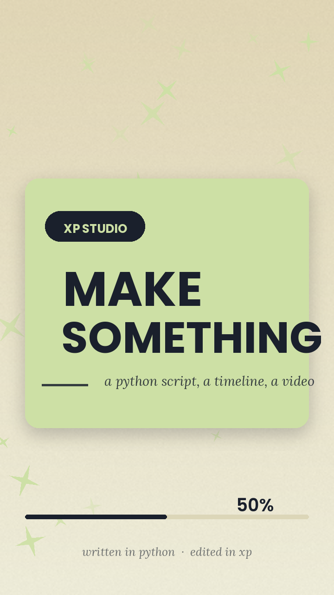
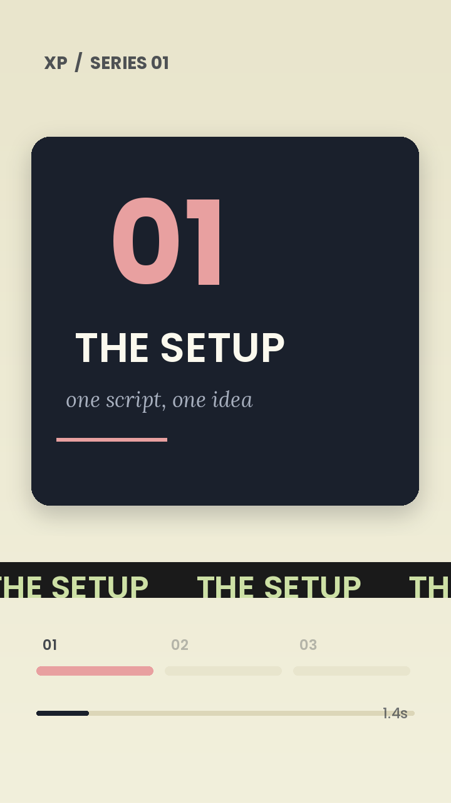

# XP

**An Android video editor for people who write their videos in Python.**

[](https://github.com/itsrawdevvvvvv-arch/xp-android/actions/workflows/android.yml)

<table>
<tr>
<td width="150"></td>
<td>

**Download:** [XP-1.0.0.apk](https://github.com/itsrawdevvvvvv-arch/xp-android/releases/latest)
· Android 9+ · arm64 · ~48 MB · sideload it (allow "install unknown apps").

Each CI build is signed with a throwaway key, so uninstall an older XP before
installing a newer one.

</td>
</tr>
</table>



| `video series 1.py` | `birthday_video_polished.py` |
|---|---|
|  |  |

You have a `.py` script that draws frames with numpy, Pillow or cv2. XP loads it,
reads its scene graph, and puts it on a CapCut-style timeline where you can move
text, recolour shapes, retime clips and keyframe anything — then exports a real
MP4 at 1080p. Your source file is never rewritten.

Kotlin + Jetpack Compose + Chaquopy (CPython 3.11). minSdk 28 (Android 9), arm64.

```
script.py  ──exec──▶  AUDIT / ob() hooks  ──▶  scene graph  ──▶  timeline
                                                                   │
        your edits (JSON) ──▶ monkey-patched blit/rrect/ptag ──▶ frame ──▶ H.264
```

## What works

| Area | Status |
|---|---|
| Load a `.py` script, audit its draw calls into a scene graph | ✅ |
| Multi-track timeline (VIDEO / MEDIA / TEXT / SHAPES / AUDIO) | ✅ drag, trim, pinch-zoom, long-press jump, tap select |
| Property sheet: Transform / Style / Timing / Keyframes | ✅ live, injected at the draw call |
| Preview 720p (540p on low-RAM), scrub cache at 540p | ✅ disk LRU, 160 MB |
| Export 1080p H.264 via MediaCodec + MediaMuxer | ✅ WorkManager foreground worker |
| Optional soundtrack | ✅ stream-copied into the MP4 (no re-encode) |
| cv2 shim on NumPy + Pillow | ✅ resize, cvtColor, putText, rect, circle, line, blur, warpAffine, VideoWriter… |
| ffmpeg shim | ⚠️ API-compatible surface, but there is **no ffmpeg binary** — encoding is MediaCodec |
| scipy | ⚠️ Chaquopy has no CPython 3.11 arm64 wheel, so `scipy` here is a NumPy-backed package (`ndimage`, `signal`, `interpolate`, `spatial`) |
| Custom springs + OKLab colour lerp + custom haptics | ✅ no Material widgets anywhere |

Honest limits: preview is Python-bound (≈7–15 fps of video on a 2 GB phone while the
UI itself stays at 60 fps), and export renders one Python frame at a time, so a
6 second clip takes roughly a minute at 1080p. Audio mixing/ducking is not
implemented — a soundtrack is copied as-is.

## The script contract

```python
DURATION = 6.0
FPS = 30

from xp_api import ob            # optional: declare intent for the timeline

ob("headline", kind="text", label="Headline")

def render_frame(t, c):          # t = seconds, c = the frame
    c.bg("#F2F0DC")              # normalised 0..1 coordinates everywhere
    c.rrect(0.08, 0.30, 0.84, 0.40, r=0.05, fill="#CDE0A5", name="card")
    c.ptag("MAKE SOMETHING", 0.5, 0.5, size=0.08, weight="bold", name="headline")
```

* `name=` is the handle the timeline and the edit layer use. Same name every
  frame → one clip.
* `AUDIT["headline"] = {...}` and `ob(...)` both work; they only add labels.
* `c.blit(numpy_array_or_pil, x, y, w, h)`, `c.ptag(...)`, `c.rrect(...)`,
  `c.star(...)`, `c.progress(...)`, `c.line(...)`, `c.circle(...)`, `c.poly(...)`.
* If a script has no `render_frame`, XP looks for `render`, `draw`, `frame`,
  `make_frame`.

Samples ship with the app: `make_video.py`, `video series 1.py`,
`birthday_video_polished.py`.

## How the edit injection works

`xp_runtime` execs the script once, then wraps every draw call on the canvas
(and any module-level `blit` / `rrect` / `ptag` helper the script defines). Each
wrapper looks up `edits[node_name]`, merges the static props with any keyframes
at the current `t`, and applies offset / scale / rotation / opacity / colour /
text substitution / time gating before the primitive draws. The `.py` file on
disk is untouched.

## Performance notes

* Preview renders on its own thread (`xp-preview`); the UI only reads the latest
  `ImageBitmap`, so a slow frame never blocks Compose.
* Scrubbing reads a 540p JPEG cache (half-second buckets, LRU on disk).
* `graphicsLayer` for every animated transform, `LazyRow`/`Canvas` for lists and
  the timeline, prefetch of the next 30 frames is done by the render thread.
* Low-RAM devices drop to 720p/24fps preview automatically.
* Export converts RGBA → YUV420 straight into the encoder's `Image` planes; no
  intermediate files.

## Build

```bash
# needs JDK 17, Android SDK 35, Python 3.11 on PATH (Chaquopy's buildPython)
gradle :app:assembleRelease
```

CI builds every push: `.github/workflows/android.yml` creates a throwaway signing
key, builds the release APK, uploads it as an artifact and publishes a GitHub
Release.

## Layout

```
app/src/main/java/ai/xp/editor/
  design/      XpTheme, Springs (OKLab), Haptics, Components  ← the whole widget kit
  core/        XpPython (Chaquopy bridge), PreviewEngine, ScrubCache,
               H264Encoder, Remuxer, ExportWorker, XpState
  model/       Scene, SceneNode, NodeEdit, keyframes
  ui/          Home, Import, Editor, Timeline, PropertySheet, Export, Settings
app/src/main/python/
  xp_runtime.py     exec, audit, monkey-patch, render
  xp_canvas.py      normalised drawing surface + edit merge
  xp_api.py         ob() / AUDIT / easing helpers
  xp_shim_cv2.py    OpenCV subset on NumPy + Pillow
  xp_shim_ffmpeg.py ffmpeg-python surface mapped onto MediaCodec
```

Fonts: Poppins (SIL OFL) and Lora (SIL OFL), bundled.
